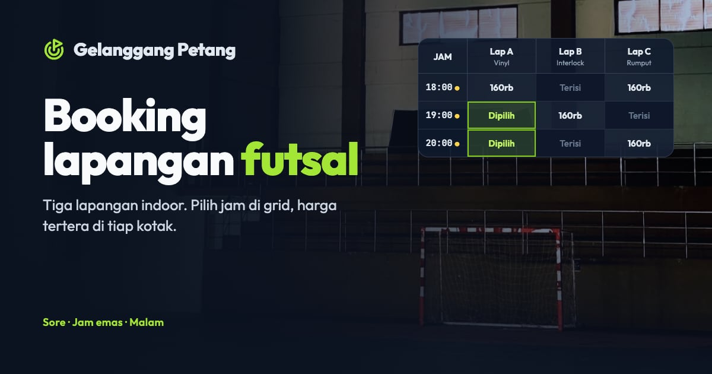

# Gelanggang Petang — Booking lapangan futsal

Tiga lapangan futsal indoor (fiktif). Paradigma **grid waktu**: jam × lapangan, pilih sampai empat jam sekaligus dengan harga di tiap kotak.

**Demo live:** https://reservasi-futsal.pintuweb.id



> Purwarupa desain. Nama usaha, data, dan harga fiktif. Tidak ada pembayaran dan tidak ada yang dikirim ke server: pemesanan disimpan di `localStorage` peramban. Tanggal dan jam dihitung dalam WIB di peramban; keterisian contoh dibuat stabil per tanggal.

## Fitur

- Tarif sore, jam emas (18.00–21.59), dan malam; Sabtu–Minggu lebih mahal.
- `/harga` — tabel tarif, jenis lantai tiap lapangan, aturan, fasilitas.
- `/sparring` — papan cari lawan: saring per level, pasang tim sendiri, ajak tanding.
- `/jadwal-saya` — booking dikelompokkan per kode, batal gratis sampai 24 jam sebelum main.

## Halaman

`/` · `/harga` · `/jadwal-saya` · `/sparring`

## Teknologi

- Next.js 15.5 (App Router) dan React 19
- Tailwind CSS v4
- JavaScript
- Framer Motion, Lucide (ikon)
- Font: Outfit (next/font)
- SEO: metadata per halaman, Open Graph, sitemap.xml, dan robots.txt

## Kredit foto

Empat foto CC0/domain publik (WordPress Photo Directory dan Wikimedia Commons), dipotong dan diseragamkan nadanya.
Rincian berkas, pembuat, tautan sumber, dan lisensi ada di [public/images/SUMBER.md](public/images/SUMBER.md).
Gambar disajikan statis dari `public/_img/` (tanpa Image Optimization Vercel); setelah mengganti foto jalankan
`node scripts/static-images.mjs . --dirs public/images`.

## Menjalankan secara lokal

```bash
npm install
npm run dev
```

Buka http://localhost:3000. Untuk build produksi: `npm run build` lalu `npm start`.

---

Bagian dari koleksi 5 aplikasi reservasi di [PortalReservasi](https://www.pintuweb.id/website-reservasi). Dibuat oleh [PintuWeb](https://www.pintuweb.id), jasa pembuatan website.
